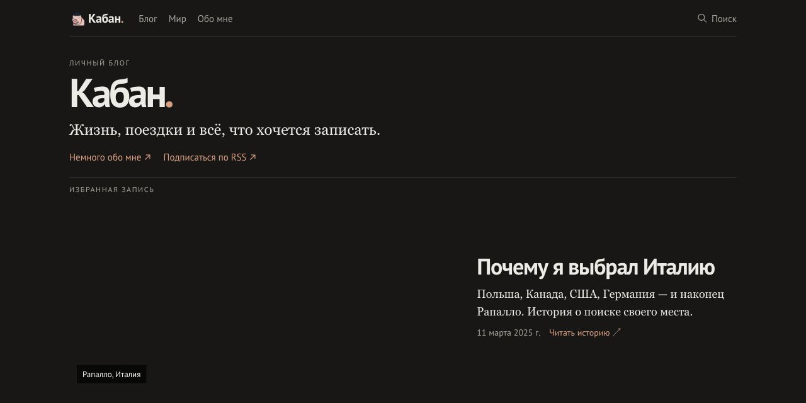
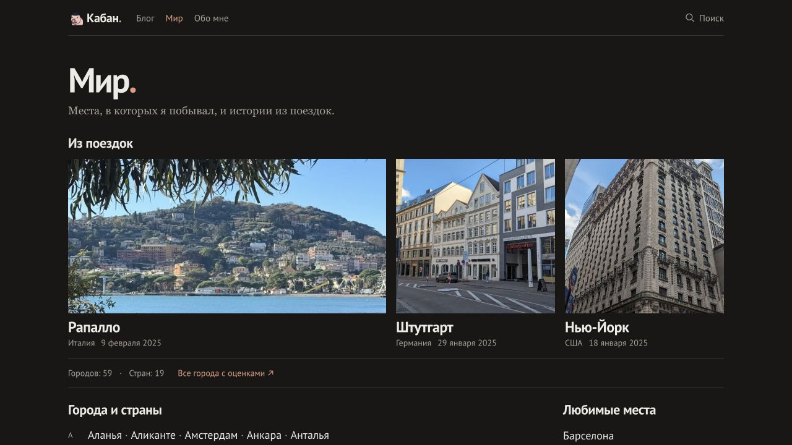
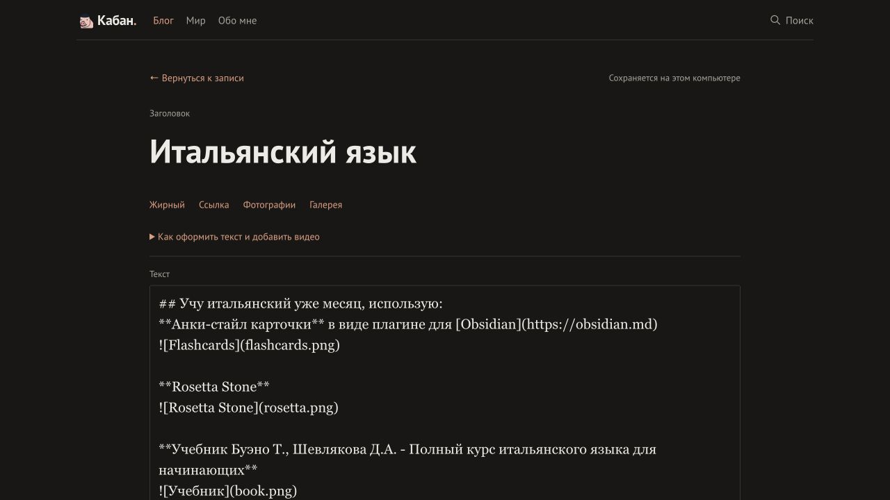
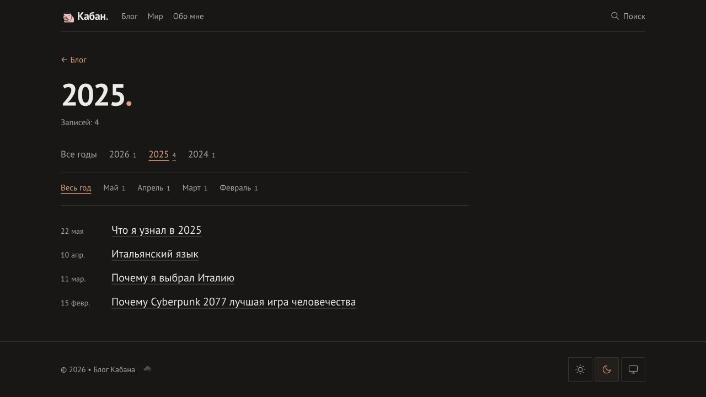

Я хотел довести этот блог до ума перед тем, как начать писать. Удобно устроиться, расставить всё по местам, а потом уже рассказывать о жизни и поездках. Правда, в какой-то момент оказалось, что переделывать блог тоже довольно увлекательно.

Сайт я собирал с помощью ИИ — в приложении Codex. Я показывал, что мне нравится, просил изменить конкретные вещи и проверял результат в браузере. Помощник разбирался в коде, вносил изменения и проверял сборку. Так у блога появился свой вид, а у меня — возможность писать прямо на его страницах.

## Начал с готовой основы

В основе сайта — [Astro Micro](https://github.com/trevortylerlee/astro-micro), готовый шаблон блога на Astro. Он дал начальную структуру: страницы, записи, меню. Не пришлось начинать с пустой папки.

Сам Astro собирает сайт из текстов, фотографий и шаблонов[^build]. На выходе получаются готовые страницы, которые можно разместить на хостинге. Это и есть статический сайт: когда читатель открывает пост, основной текст уже лежит в собранном файле.

Для моего блога этого достаточно: опубликовать рассказ, приложить фотографии и дать человеку спокойно его прочитать.

Записи хранятся в Markdown — обычных текстовых файлах. У каждого поста есть заголовок, дата, теги и сам текст. Фотографии могут лежать рядом, в той же папке. Эти файлы можно открыть без специальной программы или перенести на другой движок.

## Подсмотрел у Бирмана

Мне нравится [блог Ильи Бирмана](https://ilyabirman.ru/), особенно то, как в нём выглядят записи и путешествия. Крупные фотографии, спокойный текст, небольшая полоска с датой и тегами. Всё на своих местах.

Его движок, [Эгея](https://blogengine.ru/), стал ориентиром. На саму Эгею я не переходил: мы оставили Astro и стали заимствовать подходящие идеи.

https://blogengine.ru/

Например, я заметил, что у меня текст начинался дальше от края, чем фотографии. Снимок широкий, следующий абзац уже — и вся запись будто собрана из разных страниц. Попросил выровнять их по одной колонке. Такая мелочь повлияла на ощущение от сайта сильнее, чем очередная новая функция.

Потом уменьшили отступы, упростили шапку, оставили поиск справа. Дату поста убрали из начала: теперь она стоит снизу, рядом с темами. Под записью появились похожие истории.

Не все попытки прижились. Раздел «Заметки» мне не понравился — вернули «Блог». Первую версию карусели фотографий тоже переделали. Теперь это простая фотолента, которую можно листать; снимки открываются крупно по нажатию.

Похожим способом устроили раздел «Мир»: страны, города, фотографии и ссылки на рассказы о поездках. Он постепенно станет ещё одним способом читать блог — через места, в которых я побывал.

## Где живёт сайт

У сайта три основные части: Astro собирает страницы, GitHub хранит исходники, Netlify размещает готовый результат в интернете.

В GitHub лежат тексты, фотографии и код. Там же сохраняется история изменений. Если новая версия мне не понравится, можно посмотреть, что поменялось, и вернуть прежнее состояние.

Netlify подключён к репозиторию. Когда изменения попадают в основную ветку, он запускает сборку и публикует сайт по адресу [kaban.blog](https://kaban.blog). Мне не нужно вручную переносить каждую страницу на сервер.

Сам процесс выглядит так:

**Изменения → GitHub → сборка Astro → публикация на Netlify.**

:::details Что происходит во время сборки

Astro превращает Markdown в страницы, подготавливает фотографии и собирает стили. Затем создаются поиск, архив и связи между записями. Netlify размещает готовые файлы — читателю остаётся открыть страницу.

:::

При работе с помощником есть отдельное правило: сначала проверяем изменения на компьютере, отправляем их в GitHub только по моей команде. Увидеть новую версию в локальном браузере ещё не означает опубликовать её для всех.

## Пишу прямо в блоге

Сначала мы подключили отдельную админку на Decap CMS. Она работает, но мне хотелось другого ощущения: открыть свой блог, нажать «Редактировать» и остаться на той же странице. В Эгее мне понравилась именно эта идея.

Поэтому у сайта появился встроенный режим автора. Вход спрятан внизу страницы, рядом с названием блога. Авторизация проходит через GitHub: логин и пароль я ввожу в его стандартном окне.

После входа вижу кнопки для новой записи, редактирования и черновиков. Для обычного читателя их нет.

В редакторе можно написать текст, добавить фотографии и проверить, как будет выглядеть пост. Дата, теги и остальные поля убраны в раскрывающийся блок. Они нужны, но не должны занимать полэкрана, пока я пишу.

Фотографии можно перетащить в редактор или вставить из буфера обмена. В предпросмотре — поправить подпись, изменить порядок снимков и убрать лишний. Текст и новые фотографии сохраняются вместе.

Черновик и публикация — разные действия. На опубликованном сайте черновик сохраняется в отдельной ветке GitHub. Когда пост готов, кнопка публикации переносит его изменения в основную ветку, а Netlify собирает новую версию сайта.

Есть и восстановление несохранённого текста: редактор оставляет копию в этом браузере и предлагает вернуть её при повторном открытии. Это не синхронизация между устройствами, но помогает, если случайно закрыл вкладку.

При этом черновик здесь означает «ещё не опубликовано в блоге». Репозиторий публичный, поэтому хранить там секретные записи я бы не стал.

## Статика умеет больше, чем кажется

Поиск работает через Pagefind. Во время сборки он создаёт индекс страниц, а браузер ищет по этому индексу. Отдельный сервер для поиска не нужен.

Теги, похожие записи и архив тоже формируются при сборке. Например, у двух постов есть тег «италия» — сайт может предложить один после другого. Для архива он смотрит на даты и собирает списки по годам и месяцам.

Комментарии устроены иначе: за них отвечает Giscus, связанный с обсуждениями GitHub. Встроенный редактор тоже обращается к GitHub, когда сохраняет запись. То есть страницы статические, но вокруг них работают внешние сервисы.

У этого подхода есть компромисс. Сохранять и переносить тексты просто, а публикации нужно дождаться: после сохранения запускается сборка. Зато сам блог остаётся набором файлов, с которыми я могу работать независимо от интерфейса редактора.

## Что сделал я, а что — ИИ

Помощник мог предложить решение, написать код и проверить, собирается ли сайт. Но решить, нравится ли мне результат, приходилось самому.

Лучше всего работали конкретные замечания. «Сделай красиво» оставляло слишком много пространства для догадок. «Текст и фото должны начинаться на одной линии» уже давало понятную задачу. Скриншот и пример другого сайта помогали ещё больше.

Иногда помощник уверенно делал то, что я потом просил убрать. Это тоже часть работы: посмотреть, назвать проблему и переделать. Код может пройти проверку, а страница всё равно выглядеть странно.

Мне понравилось, что между идеей и работающим вариантом стало меньше расстояния. Можно попросить редактор внутри блога, увидеть его в браузере и дальше обсуждать уже конкретную вещь: где кнопка, как добавляется фотография, что происходит после сохранения.

Так я и собрал нынешнюю версию сайта. В ней ещё есть тестовые страницы, а некоторые новые функции пока проверяются локально. Но основное уже работает: я могу написать историю, приложить снимки и опубликовать её на своём домене.

Теперь осталось перестать бесконечно обустраивать место для записей и начать им пользоваться.

[^build]: Сборка — подготовка готовых страниц из исходных файлов. Она запускается при публикации, а не при каждом посещении блога.
